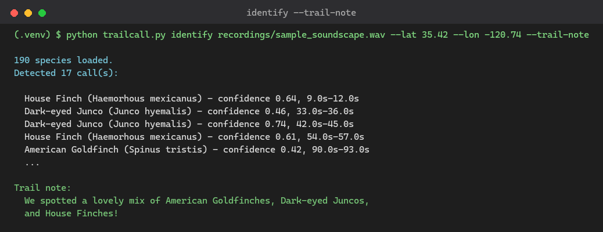
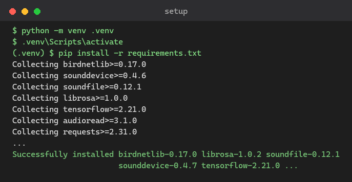
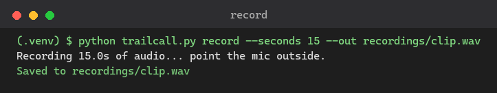
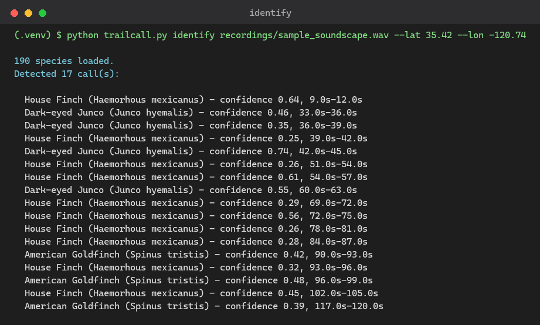

# TrailCall

🌲🐦 *"What bird is that?"* — the question every hike eventually asks, usually
right when there's no signal to look it up.

TrailCall answers it on the spot. Record a clip on the trail, and it tells you
what's singing — species name, confidence, timestamp — using an open-weight
acoustic model running entirely on your own device. No signal, no account,
no cloud call, no data leaving the woods with you.

Built for Hacktoberfest 2026's Week 1 "Touch Grass" challenge: build
something with open-source AI at its core that gets people outside.

## Features

- 🎙️ **Record or analyze** — capture a clip straight from the mic, or point it at an existing recording
- 🧠 **Offline species ID** — runs [BirdNET](https://github.com/kahst/BirdNET-Analyzer), an open-weight acoustic classifier, fully on-device via `birdnetlib`
- 📍 **Location-aware** — pass lat/lon to narrow the candidate species list and improve accuracy
- ⏱️ **Timestamped detections** — know exactly which seconds of the clip each call came from
- 📝 **Trail notes via Gemma** — optional `--trail-note` flag turns raw detections into one friendly sentence using a local Gemma model (via Ollama) — no API key, no cloud
- 🔒 **Zero network calls at inference time** — once models are cached locally, nothing phones home

## Demo

```
$ python trailcall.py identify recordings/sample_soundscape.wav --lat 35.42 --lon -120.74 --trail-note

190 species loaded.
Detected 17 call(s):

  House Finch (Haemorhous mexicanus) - confidence 0.64, 9.0s-12.0s
  Dark-eyed Junco (Junco hyemalis) - confidence 0.46, 33.0s-36.0s
  Dark-eyed Junco (Junco hyemalis) - confidence 0.35, 36.0s-39.0s
  House Finch (Haemorhous mexicanus) - confidence 0.25, 39.0s-42.0s
  Dark-eyed Junco (Junco hyemalis) - confidence 0.74, 42.0s-45.0s
  ...
  American Goldfinch (Spinus tristis) - confidence 0.39, 117.0s-120.0s

Trail note:
  We spotted a lovely mix of American Goldfinches, Dark-eyed Juncos, and House Finches!
```

*(Real output from a 2-minute field recording, full pipeline: BirdNET detection + Gemma trail note via Ollama.)*



## Real-World Use Cases

- **Solo backcountry hikers** — get an answer on the spot, days away from signal
- **Citizen science surveys** (eBird, local Audubon counts) — collect data in habitat where cloud tools don't reach
- **Field researchers** — batch-process acoustic monitoring recordings in camp with no cloud dependency or per-call cost
- **Guided nature walks** — confirm a call in real time without breaking the moment to look it up
- **Off-grid properties** — identify birds around a remote home or homestead with no connection at all

## Why open-source AI here

```
   phone / laptop mic
          |
          v
   [ record clip ]  <-- stays on-device, never uploaded
          |
          v
   [ BirdNET .tflite model ]  <-- runs locally, cached after first download
          |
          v
   [ species + confidence + timestamp ]
```

- **Offline** — BirdNET's `.tflite` model runs locally; no signal needed deep in the woods.
- **Privacy** — audio never leaves your machine, nothing is uploaded or logged remotely.
- **Cost** — no per-call API fees, unlike cloud-based bird-ID services.
- **Customizable** — swap in a region-specific or custom-trained model via `custom_model_path`.

## Setup

```bash
python -m venv .venv
.venv\Scripts\activate
pip install -r requirements.txt
```



## Usage

Record 15 seconds from your mic:

```bash
python trailcall.py record --seconds 15 --out recordings/clip.wav
```



Identify species in a clip (lat/lon narrows the candidate species list and improves accuracy):

```bash
python trailcall.py identify recordings/clip.wav --lat 35.42 --lon -120.74
```



Add a spoken-style trail note generated by a local Gemma model (requires [Ollama](https://ollama.com) running with the model pulled):

```bash
ollama pull gemma4:e2b
python trailcall.py identify recordings/clip.wav --lat 35.42 --lon -120.74 --trail-note
```

```
Trail note:
  Heard a mix of House Finches and a Dark-eyed Junco working the brush nearby.
```

If Ollama isn't running, `--trail-note` fails gracefully with setup instructions instead of crashing — species detection still prints normally either way.

## Limitations

- Accuracy depends heavily on mic quality and background noise (wind, traffic, overlapping calls all hurt confidence scores)
- BirdNET's candidate list is tuned for the regions/seasons it was trained on — accuracy drops outside its training distribution
- First run downloads the model (~50MB); after that it's fully offline
- `record` requires a working microphone and hasn't been tested on every OS/audio backend combination
- `--trail-note` requires Ollama running locally with a Gemma model pulled; without it, species detection still works, just without the summary sentence

## Built with

- [BirdNET-Analyzer](https://github.com/kahst/BirdNET-Analyzer) — open-weight acoustic species classifier
- [birdnetlib](https://github.com/joeweiss/birdnetlib) — Python wrapper around BirdNET
- [sounddevice](https://python-sounddevice.readthedocs.io/) / [soundfile](https://pysoundfile.readthedocs.io/) — mic capture and audio I/O
- [Gemma](https://ai.google.dev/gemma) via [Ollama](https://ollama.com) — local open-weight LLM for the optional trail-note summary

## Prize Categories

- **Best Use of Gemma** — the optional `--trail-note` feature runs Gemma locally through Ollama to turn raw species detections into a one-line, friendly trail note, with no API key and no cloud call

## Status

Proof-of-concept for the Hacktoberfest Week 1 "Touch Grass" DEV challenge.
Next steps: batch-process a folder of field recordings, add a spoken-audio
summary so no screen is needed at all, and a small local LLM pass to turn raw
detections into a one-line trail note ("Heard: Red-winged Blackbird, 92% confidence").

## License

MIT
